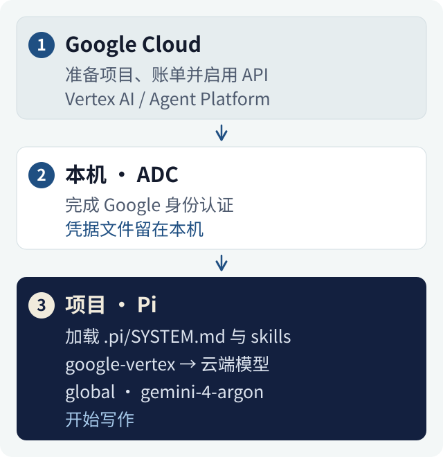

我想把 Google Cloud 上的 Gemini 4 Argon 接进日常使用的终端 Agent，再把它配成一个中文写作搭档。最后选了 Pi：模型调用走它原生的 `google-vertex` Provider，写作身份和技能放在项目里，其他项目继续沿用各自的配置。

这篇从云端准备开始，记录到一次实际请求返回 `OK`，以及如何确认写作提示词和技能真的加载进了新会话。接入记录来自 2026 年 11 月 5 日，环境是 macOS、Node.js 24 和 Pi 1.5.0。命令中的 `your-project-id` 和 `~/novel-project/` 都是示例，使用时换成自己的值。



## 先准备 Google Cloud

这里有三个名字容易混在一起：Google Cloud 项目负责资源、权限和结算；ADC 负责让本机程序找到 Google 身份；Pi 负责把这个模型放进日常工作流。

Google 当前文档和控制台把相关平台称为 **Gemini Enterprise Agent Platform**，模型调试页面叫 **Agent Studio**。本文仍会用到 Vertex AI 这个名字，因为 Pi 的 Provider 名称是 `google-vertex`，API 服务名也沿用 `aiplatform.googleapis.com`。[平台更名说明](https://docs.cloud.google.com/gemini-enterprise-agent-platform/release-notes#April_22_2026)

### 账号、试用和结算

先登录 [Google Cloud 控制台](https://console.cloud.google.com/)，按页面提示准备结算账户。符合资格的新用户可以申请试用；截至本文核查时，官方提供的是 **300 美元、90 天**的试用额度，注册过程会验证付款方式。资格与适用范围以[官方试用说明](https://docs.cloud.google.com/free/docs/free-cloud-features)为准。

本文使用 Cloud 项目结算。Google AI Studio 的 Gemini API 有另一套使用和计费入口，选工具时要看清 Provider。试用额度是否覆盖某笔用量，要在 Cloud Billing 的明细和 Credits 中核对。

### 项目、API 和权限

在控制台完成下面几件事：

1. 新建或选择一个 Google Cloud 项目，记下它的 **Project ID**。后面的命令使用 ID。
2. 确认该项目已经关联有效的结算账户。
3. 启用 Agent Platform API，服务名是 `aiplatform.googleapis.com`。
4. 确认当前 Google 身份有调用模型的权限。官方通用角色是 `roles/aiplatform.user`；启用 API 则需要另外的服务启用权限。使用他人管理的项目时，请项目管理员按需配置。

这几项与[官方准备流程](https://docs.cloud.google.com/gemini-enterprise-agent-platform/models/start)一致。项目、API 和权限准备好之后，再调本机客户端，排查起来会清楚很多。

### 先在网页做一次小测试

进入当前项目的 Agent Studio，选择：

- 模型：`gemini-4-argon`。
- 区域：`Global`。
- 思考等级：`Low`。
- 提示词：「只回复 OK」。

网页成功返回之后，说明这个项目已经完成了一次模型调用。接下来再验证终端使用的身份和客户端配置。模型名称、支持区域和思考等级见 [Argon 官方指南](https://docs.cloud.google.com/gemini-enterprise-agent-platform/models/guides/gemini-4-argon)。

## 在本机建立 ADC

先按[官方指南安装 Google Cloud CLI](https://docs.cloud.google.com/sdk/docs/install-sdk)，在终端确认 `gcloud --version` 能正常运行。

下面的环境变量先设置在当前终端里，后面启动 Pi 时会用到：

```sh
export GOOGLE_CLOUD_PROJECT="your-project-id"
export GOOGLE_CLOUD_QUOTA_PROJECT="$GOOGLE_CLOUD_PROJECT"
export GOOGLE_CLOUD_LOCATION="global"
```

然后初始化 gcloud，并单独建立应用使用的 ADC：

```sh
gcloud init --project="$GOOGLE_CLOUD_PROJECT"

gcloud auth application-default login \
  --project="$GOOGLE_CLOUD_PROJECT"

gcloud auth application-default set-quota-project \
  "$GOOGLE_CLOUD_PROJECT"
```

登录过程中会打开浏览器，由自己选择账号并完成授权。`gcloud init` 配置的是命令行账号与项目；`application-default login` 建立的是应用所用凭据。Pi 的 Google 客户端通过 ADC 获取和刷新访问令牌。[两种凭据的区别](https://docs.cloud.google.com/docs/authentication/application-default-credentials)

`set-quota-project` 把本次使用的项目写进 ADC 配额设置。执行它需要登录身份在目标项目上拥有 `serviceusage.services.use` 权限；遇到权限错误时，先核对登录账号和目标项目。[配额项目命令](https://docs.cloud.google.com/sdk/gcloud/reference/auth/application-default/set-quota-project)

ADC 的凭据文件交给本机认证库管理。下面配置 Pi 时，用到的是 Provider、项目和区域。

## 把 Argon 接进 Pi

下面固定到这次使用的 Pi 1.5.0。这个版本要求 Node.js 22.19.0 以上，我使用的是 Node.js 24。[安装说明](https://github.com/earendil-works/pi/blob/v1.5.0/packages/coding-agent/README.md#getting-started)

```sh
npm install -g --ignore-scripts @earendil-works/pi-coding-agent@1.5.0
pi --version
```

先查看当前模型目录，再检查本机凭据能否被 Provider 找到：

```sh
pi --list-models argon
pi auth check --provider google-vertex --json
```

第一条应当能找到 `google-vertex` 下的 `gemini-4-argon`。模型目录需要更新时，可运行 `pi update --models` 后重新查询，见[目录更新说明](https://github.com/earendil-works/pi/blob/v1.5.0/packages/coding-agent/docs/models.md)。第二条检查的是凭据解析状态。实际调用用下面这条命令，它会产生模型用量：

```sh
pi --provider google-vertex \
   --model gemini-4-argon \
   --thinking low \
   --no-tools \
   -p '只回复 OK'
```

这次接入后的实际请求返回了 `OK`。到这里，云端项目、ADC 和 Pi 的调用链就接通了。`--no-tools` 让这次小测试集中在文字请求上，项目文件的操作放到后面再做。[Provider 配置](https://github.com/earendil-works/pi/blob/v1.5.0/packages/coding-agent/docs/providers.md#google-vertex-ai)、[CLI 参数](https://github.com/earendil-works/pi/blob/v1.5.0/packages/coding-agent/docs/cli.md)

## 给写作项目单独配置

模型接通后，我希望进入小说目录就使用写作规则。项目里的三个位置分工如下：

```text
novel-project/
├── AGENTS.md          项目约定：设定位置、稿件目录和修改规则
└── .pi/
    ├── settings.json  默认模型、思考等级和技能来源
    ├── SYSTEM.md      这个项目的写作身份
    └── skills/        按任务加载的项目技能
```

### 设定默认模型

在项目中创建 `.pi/settings.json`：

```json
{
  "defaultProvider": "google-vertex",
  "defaultModel": "gemini-4-argon",
  "defaultThinkingLevel": "low"
}
```

项目配置的作用范围是这个目录；其他项目继续使用各自或全局的设置。首次启动时，按 Pi 的提示确认自己信任这个项目。[设置的作用范围](https://github.com/earendil-works/pi/blob/v1.5.0/packages/coding-agent/docs/settings.md)

### 写入项目身份

`.pi/SYSTEM.md` 会替换这个项目的默认系统提示词。公开示例可以从下面几行开始，再用自己的样章和项目规则细化：

```markdown
你是中文小说编辑与创作搭档。

以人物动机、场景张力、叙事视角和语言质感判断稿件。
续写请求直接输出正文；提纲、分析和修改说明按用户要求提供。
沿用项目中的设定、时间线和人物声音，以认可的样章作为文风依据。
修改已有稿件时，先读取相关设定和上下文，再编辑对应文件。
对需要作者决定的情节分歧，给出具体选项，保留作者的选择。
```

我把长期的项目事实和稿件约定放进 `AGENTS.md`，把角色与输出习惯放进 `SYSTEM.md`。Pi 会另外加载项目上下文；替换默认提示词以后，项目约定仍然参与后续请求。[项目提示词配置](https://github.com/earendil-works/pi/blob/v1.5.0/packages/coding-agent/docs/configuration.md)

### 核对技能来源

我第一次检查新会话时，发现系统提示词里有 **47 个技能：13 个项目技能，加上 34 个从全局带入的技能**。对这个写作项目，全局带入的那一批增加了很多无关上下文。

这些技能来自 `~/.agents/skills/`。我在同一份 `.pi/settings.json` 里增加了来源过滤，完整示例如下：

```json
{
  "defaultProvider": "google-vertex",
  "defaultModel": "gemini-4-argon",
  "defaultThinkingLevel": "low",
  "skills": [
    "~/.agents/skills",
    "!~/.agents/skills/**"
  ]
}
```

在 Pi 1.5.0 中，这两项需要配合使用：前一项把该目录纳入项目资源设置，后一项再将其中的技能排除。它针对的是这一处来源；如果技能还来自其他目录或已安装的包，要继续核对各自的来源。[资源过滤设置](https://github.com/earendil-works/pi/blob/v1.5.0/packages/coding-agent/docs/settings.md#resources)、[发现与过滤实现](https://github.com/earendil-works/pi/blob/v1.5.0/packages/coding-agent/src/core/package-manager.ts)

启动时注入的技能目录主要包含名称、说明和路径；完整技能正文按任务需要读取。这次字符数的变化对应技能目录这一段。[技能加载方式](https://github.com/earendil-works/pi/blob/v1.5.0/packages/coding-agent/docs/skills.md#understand-how-skills-load)

## 从新会话核查实际效果

我用一个新会话验收默认配置。续接旧会话会恢复它已经记录的模型和思考等级，适合继续旧任务；验证刚改的默认值时，新会话更直接。

Pi 的历史默认保存在 `~/.pi/agent/sessions/`，按项目路径分目录，每个会话是一个 `.jsonl` 文件。首次请求会记录完整系统消息，其中的 `message.sections` 可以用来检查：

- `preamble`：写作身份是否已经加载。
- `project_context`：项目约定是否来自当前目录。
- `skills`：技能的数量和来源是否符合预期。
- `cwd`：工作目录是否正确。

再结合会话中的模型与思考等级记录，核对 `google-vertex`、`gemini-4-argon` 和 `low`。后续系统消息可能以增量形式保存，查新会话的首次完整记录最容易对应这次配置。[会话格式](https://github.com/earendil-works/pi/blob/v1.5.0/packages/coding-agent/docs/session-format.md#sessionmessageentry)

这次调整后的结果是：

| 检查项 | 调整结果 |
| --- | --- |
| 新会话加载的技能 | 47 个 → 13 个，全部来自写作项目 |
| 技能目录文字量 | 19,400 → 4,746 字符，减少约 75.5% |
| 写作提示词与项目约定 | 均从新会话记录中确认加载 |
| 模型与思考等级 | Gemini 4 Argon，Low |
| 实际请求 | 返回 `OK` |

原始会话保留在本机。文章展示配置方法和汇总结果，方便复现这条检查路径。

## 日常启动与费用核对

前面的 `export` 作用于当前终端。新开终端时，需要重新提供项目与区域；例如在项目目录运行：

```sh
cd ~/novel-project

GOOGLE_CLOUD_PROJECT="your-project-id" \
GOOGLE_CLOUD_QUOTA_PROJECT="your-project-id" \
GOOGLE_CLOUD_LOCATION="global" \
pi
```

需要长期使用时，可以把这段启动命令保存在自己的本机脚本中。项目里的模型、身份和技能设置则继续放在 `.pi/`。

我先固定 Low，让最初的连接测试和日常起稿有一致的起点。Medium 和 High 对中文长篇写作的价值，还需要用同一份细纲、样章和评价标准做对照。接通模型和技能隔离是这次已经验证的部分，写作质量留给真实稿件来检验。

费用方面，思考 tokens 也计入输出用量。Google 当期对 Argon 的促销采用返还 credits 的方式；Pi 显示的费用可用于估算，实际收费和试用金抵扣要对照 Cloud Billing。本文接入记录中的赠金抵扣仍待账单核对。[官方价格与促销说明](https://cloud.google.com/model-garden/pricing)

---

这篇文章由 Codex 根据个人配置记录和官方文档起草，示例中的账号、项目和路径使用通用占位符。
